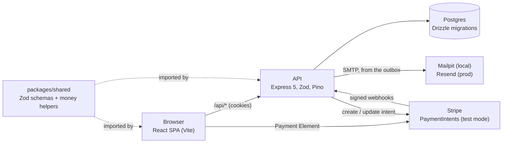
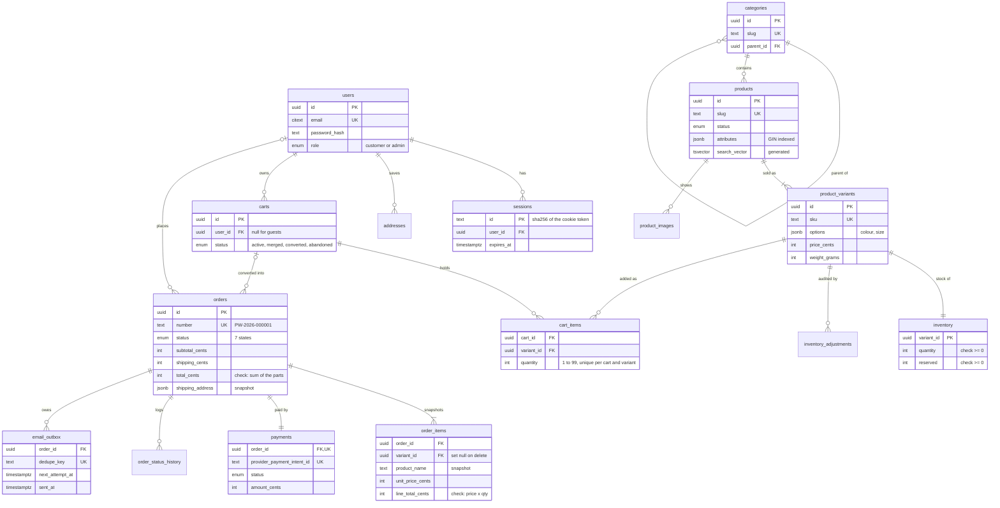
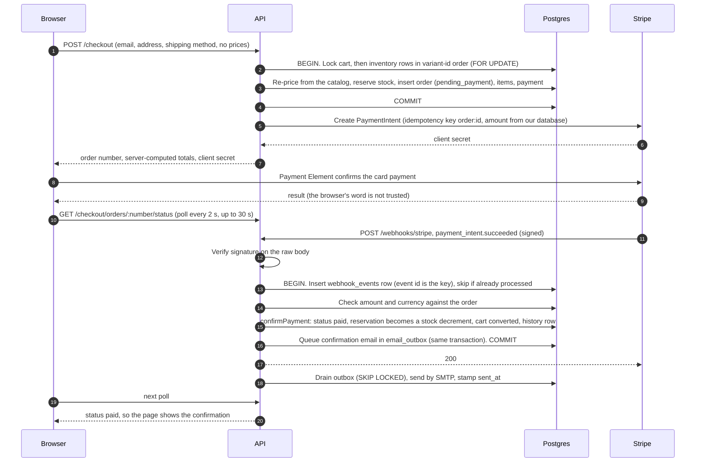

# Pawsome

A full-stack e-commerce store for a fictional pet supplies shop. React and TypeScript on the front end, an Express 5 API, Postgres through Drizzle, and Stripe in test mode. It is a portfolio project, built to show how a store behaves when two shoppers want the last item, when a webhook arrives twice, or when the payment provider is slow.

- **Live demo:** <https://pawsome-store-tau.vercel.app> (Stripe test mode: pay with `4242 4242 4242 4242`). How it is deployed: [docs/DEPLOYMENT.md](docs/DEPLOYMENT.md).
- **Test card:** `4242 4242 4242 4242`, any future expiry, any CVC, any postcode. Stripe test mode never moves money.
- **Scope:** browse and search, variants (colour by size), a server-side cart that survives login, guest and account checkout, order history, and an admin area for products, stock and orders.
- **Content:** the brand, products and copy are made up, there are no live animals for sale, and the product images are AI-generated (see [image credits](apps/web/public/products/CREDITS.md)).

## Screenshots

| Home | Product list with filters |
| --- | --- |
|  |  |

| Product page | Cart |
| --- | --- |
|  |  |

| Checkout (shipping step) | Paid order confirmation |
| --- | --- |
|  |  |

| Admin order detail | Phone (390 px) |
| --- | --- |
|  |   |

The confirmation and admin shots come from the same simulated-payment flow the end-to-end tests use, because no Stripe keys are configured yet (see [what I would do differently](#what-i-would-do-differently-and-whats-next)).

## Architecture



A pnpm monorepo with three packages: `apps/web`, `apps/api` and `packages/shared`. The shared package holds the Zod schemas for every request and response, so the contract is one definition that both sides compile against, and the web client parses every response with it at runtime. In production web and API share one Vercel origin (the API runs as a Vercel Function under `/api/*`), so the session cookie is first-party.

## Stack, and why

The full reasoning, with the alternatives I rejected, is in the [decisions log](docs/plan/04-decisions-log.md). The short version:

| Choice | Why |
| --- | --- |
| React 18, Vite, React Router, TanStack Query | A plain SPA with no framework magic. TanStack Query does the server cache, retries and invalidation. |
| Tailwind plus a small set of own components | No UI kit: the design system is part of the work, and the bundle stays small. |
| Express 5, Zod, Pino | Express 5 handles async errors natively. Validation, errors, auth and CSRF are explicit middleware I can point at. |
| Drizzle and plain SQL migrations | SQL-shaped, so transactions, `FOR UPDATE` and partial indexes are visible, not hidden behind an abstraction. Migrations are readable files. |
| Postgres 16 | Row locks, check constraints and full-text search (`tsvector`) cover stock, money and search with no extra service. |
| Own cookie sessions and argon2id | Sessions are revocable and explainable, with no refresh-token dance. See the security notes below. |
| Server-side cart from day one | One build, no `localStorage` cart to replace later; prices always come from the catalog. |
| Stripe PaymentIntents and Payment Element | Keeps the checkout UI in the project and exercises webhooks and amount integrity. |
| Email outbox, Mailpit locally, Resend in production | Order emails are real, and a crash cannot lose one. |
| Vitest, Supertest on real Postgres, Playwright | Three test layers, described below. |

## Data model

The main tables. Every column is in [the data model doc](docs/plan/01-data-model.md), and the schema itself is in [apps/api/src/db/schema](apps/api/src/db/schema). Money is integer cents everywhere.



Not drawn: `shipping_methods` (flat plus per-kilogram pricing) and `webhook_events` (the Stripe event id is the primary key, which is what makes redelivery safe). Order items copy the product name, price and image at purchase time, so editing or deleting a product never rewrites an old order.

## Checkout flow



## Engineering notes

**Concurrency-safe stock.** Stock is two columns, `quantity` and `reserved`. Placing an order locks the cart, then every involved inventory row in variant-id order (a fixed order prevents deadlocks between two crossing carts), then reserves with a conditional `UPDATE`. Check constraints (`quantity >= 0`, `reserved >= 0`) are the last line of defence. A reservation holds stock without removing it, so an abandoned payment is reversible: a sweeper checks orders still unpaid after 30 minutes against Stripe's own records, cancels the intent first (so a late tab cannot still pay), then releases the stock. A property-style test runs seeded random sequences of checkouts, payments, cancellations, admin changes and sweeps, some raced in pairs, and asserts after every step that stock is never negative and `reserved` equals the units in pending orders.

**Webhook idempotency and the amount check.** The route is mounted before `express.json()` so the signature is verified against the exact bytes Stripe sent. Each event is handled in one transaction that first inserts a row keyed by the Stripe event id and skips events already processed; if the handler throws, everything rolls back and the answer is a 500 so Stripe redelivers. On `payment_intent.succeeded` the handler compares the amount and currency with the order, and a mismatch leaves the order pending and logs an alarm instead of shipping it. The request that creates the order carries no price at all: totals are computed on the server from database prices.

**Outbox.** "An email is owed" is written in the same transaction as the status change, with a unique key per kind and order, so a replayed webhook queues nothing new and a crash cannot lose a confirmation. A drainer claims due rows with `FOR UPDATE SKIP LOCKED` and retries with exponential backoff, so mail trouble never fails a webhook. The one accepted gap is a crash between sending and stamping, which can send an email twice.

**Session security.** The cookie holds a random 32-byte token; the database stores only its SHA-256. The cookie is `HttpOnly`, `SameSite=Lax` and `Secure` in production. Passwords use argon2id, and an unknown email costs the same time as a wrong password. Login always issues a fresh session id (against fixation), changing a password revokes every other session, credential endpoints are rate limited per address and email, and CSRF is handled by SameSite plus an `Origin` check. Account and order queries put the owner in the `WHERE` clause and answer 404 for "not yours", so order numbers cannot be probed.

**Cart merge.** A guest cart is a server row named by a signed cookie, and the cart id never comes from the request body. On login or registration the guest lines are merged into the account cart in one transaction: same-variant quantities are summed and clamped to what is available, unbuyable lines are dropped, and the guest cart is marked `merged` so a double submit adds nothing. Locks are always taken guest first, then user. A failed merge never fails the login.

**Guard-rails for later SEO and Core Web Vitals work.** The app is a SPA, but nothing blocks server rendering or prerendering later: all fetches go through typed functions in `apps/web/src/api/` (none inside components), routes live in one `routes.tsx` and are split per route, URLs are stable (`/products/<slug>`, `/c/<category>`), list state lives in the URL, every page sets its tags through a small `<Seo>` component, analytics calls go through a typed no-op `track()`, and `data-testid` attributes follow a naming convention.

## Testing

Three layers, all run in CI on every push ([workflow](.github/workflows/ci.yml)). Counts are from a full local run.

| Layer | Tools | What it covers | Result |
| --- | --- | --- | --- |
| Unit and component | Vitest, Testing Library, msw | Pure rules (pricing, shipping, the order state machine), schemas, and the web app with the API replaced by msw | shared: 338 tests; web: 1,015 tests |
| Integration | Vitest, Supertest, real Postgres | Every endpoint against a real database, including parallel requests on one cart and the inventory invariants | api: 1,504 passed, 2 skipped (they call the live Stripe test API and need keys) |
| End to end | Playwright, Chromium | Browse, cart, auth, guest and account checkout through to a paid confirmation, account pages, the admin flows, content and trust pages, promotions, loyalty, reviews, returns, the agent tools, and the store views with their currencies | 83 passed, 1 skipped (the real-card test, which needs Stripe keys) |

Statement coverage at the end of phase 11: shared 100 %, web 95.0 %, API 96.5 % (`pnpm coverage`, figures from the coverage review in the [build journal](docs/plan/05-build-journal.md)). A high percentage only says which code never ran, so the invariant and concurrency tests do the real work on stock and money. Without a Stripe key the API boots a fake payment gateway under `NODE_ENV=test`, and the e2e suite pays orders through a test-only webhook simulator that exists only in that mode and needs a secret header. CI also scans the full history for secrets (gitleaks) and runs a warn-only dependency audit.

## What I would do differently, and what's next

- **No real Stripe run yet.** The Stripe code is covered against a fake gateway, and the card test is written but skipped until test keys are added. Until a real card has gone through the Payment Element, the Stripe path is tested but not proven end to end.
- **Free-tier demo.** After idle time the first request is slower (function cold start plus Neon waking its compute, roughly 1 to 4 seconds). Scheduled jobs run hourly from GitHub Actions instead of in-process timers.
- **Email on the demo.** Resend's free tier without a verified domain only delivers to the account owner's address, so other customers' confirmation emails are rejected while the order still completes.
- **Product images are AI-generated.** They are original and record their prompts in the credits file, but they are not photographs of real products.
- **The catalog query is simple on purpose.** The variant summary aggregates all active variants on each request. At the seeded 47 products the filtered list query runs in under a millisecond and a local load check gave about 500 requests per second; at a hundred times the catalog I would cache it or keep a materialised summary.
- **SPA.** Search engines and Core Web Vitals would be better served by prerendering or server rendering. The guard-rails above are there so that is an addition, not a rewrite.
- **Not built:** discount codes, reviews, wishlists, subscriptions, multiple currencies. Tax is always zero.

## Local setup

Needs Node 22, pnpm and Docker. Run from the repository root. In a clean clone with a warm package cache this reached a healthy API in about a minute (install 13 s, migrate and seed 2 s), so a cold install fits comfortably inside ten minutes.

```sh
nvm use                      # Node 22 (.nvmrc); skip if you manage Node otherwise
corepack enable              # gives you the pinned pnpm
pnpm install
cp .env.example .env         # the defaults work as they are; Stripe keys stay empty
docker compose up -d         # Postgres on 5432, Mailpit on 8025
pnpm db:migrate
pnpm db:seed                 # prints the demo logins
pnpm dev                     # web http://localhost:5173, API http://localhost:3000
```

Check it: `curl localhost:3000/api/v1/health` answers `{"status":"ok","db":"ok",...}`. Captured emails are at http://localhost:8025.

Without Stripe keys the checkout stops at the payment step with a message and creates no order. To take a test payment, put the test keys from your Stripe dashboard in `.env` (`STRIPE_SECRET_KEY=sk_test_...`, `STRIPE_PUBLISHABLE_KEY` and `VITE_STRIPE_PUBLISHABLE_KEY=pk_test_...`; live keys are refused at boot), forward webhooks with `stripe listen --forward-to localhost:3000/api/v1/webhooks/stripe`, put the printed `whsec_` value in `STRIPE_WEBHOOK_SECRET`, and restart `pnpm dev`.

Checks, as CI runs them:

```sh
pnpm typecheck && pnpm lint && pnpm format:check && pnpm test
pnpm e2e                     # needs the services above and a migrated, seeded database
pnpm db:reset                # drop and reseed the development data
```

See [CONTRIBUTING.md](CONTRIBUTING.md) for the commit style and branch flow.

## Deployment

Free tiers only, no card needed: Neon (Postgres) and Vercel (web plus the API as a function), with Stripe in test mode, GitHub Actions for scheduled jobs and Resend for email. The step-by-step guide, including the order to do things in and a smoke checklist, is [docs/DEPLOYMENT.md](docs/DEPLOYMENT.md).

## Licence and credits

[MIT](LICENSE). Product image credits and the generation prompts are in [apps/web/public/products/CREDITS.md](apps/web/public/products/CREDITS.md). The build plan, the decisions log and a journal of what each step did are in [docs/plan](docs/plan).
